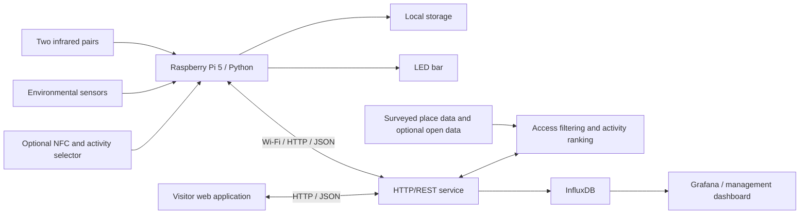

# NatureMatch
IoT station (Raspberry Pi 5) + API + activity assessment + Grafana. See `docs/`.

## Layout
- `src/naturematch/station`    sensors, IR counter, LED  (runs on the Pi)
- `src/naturematch/common`     shared data model (Observation, Quality, units)
- `src/naturematch/service`    HTTP/JSON API + InfluxDB persistence
- `src/naturematch/assessment` access filter + activity profiles (pure logic)
- `src/naturematch/web`        static web UI
- `deploy/`                    systemd units, Docker stack (InfluxDB, Grafana)

## Quick start
    make install && cp .env.example .env && cp config/station.example.yaml config/station.yaml
    make stack-up && make run-api && make run-station

# Project description

**IoT for reconnecting with nature** · IoT Challenge 2026–27

NatureMatch is a proposed Internet of Things system to help people choose nearby green spaces that suit their intended activity, available time, preferences and access needs. Connected monitoring stations would measure visitor movements and environmental conditions, while a web application would turn those measurements into explained recommendations for studying, running, relaxing or meeting others outdoors.

**Project status: proposal and planning. Implementation has not started.** The hardware, software and features described below are planned work, not existing capabilities. This README summarizes the [project proposal](Docs/IoTChallenge.pdf).

## Purpose and intended users

Knowing where a park is does not tell someone whether its current conditions suit their plans. NatureMatch aims to reduce that uncertainty so students, university staff and citizens can make nearby nature part of everyday life. The initial setting is campus gardens and green spaces in Bilbao, with a longer-term vision of supporting additional parks and institutions.

The proposed service has two audiences:

- **Visitors:** a browser-based application to find suitable places, understand the reasons for a recommendation and then put the screen away.
- **University and park managers:** a separate dashboard to inspect aggregate visitor estimates, environmental measurements and historical trends.

For example, a student with a break between classes could look for a quiet place to study within a short journey, requiring step-free access and tables. NatureMatch would first check recorded access and facility information, then rank suitable places using available measurements. It would explain the result, show when readings were taken and clarify that the presence of tables does not guarantee a free table.

## What the system would do

### Estimate occupancy

Two infrared transmitter/receiver pairs at an entrance would detect the order in which their beams are interrupted. Software on a Raspberry Pi would use those sequences to estimate entries and exits and maintain an occupancy estimate from a known initial count.

This estimate must be validated against manual observations. Occupancy for an entire area requires coverage of every entrance; the initial field test is limited to one entrance in a controlled setting. Missed crossings or interruptions in sensing would require reconciliation of the count.

### Measure local conditions

Grove sensors would collect temperature, humidity, sound level, light, UV and air-quality-related readings. Records would include timestamps, units and quality information so the interface can distinguish current, stale and unavailable data. Occupancy and noise would remain separate measurements.

The exact modules and their calibration will determine which claims are possible. The proposed Grove gas sensor provides a qualitative response, not pollutant concentrations or an official Air Quality Index. The UV sensor provides an approximate indicator, not an official UV Index. Noise readings need calibration before being presented as reliable decibel values.

### Recommend places by activity and access needs

The recommendation process would first check essential requirements, such as step-free access, path surfaces and rest facilities, against surveyed place information. It would then rank compatible places with activity-specific preferences: quiet studying, for example, would place different weight on noise and busyness than socializing.

Recommendations would explain their reasons and data limitations. Unknown access characteristics would need to remain explicit rather than being presented as verified suitability. Public weather, environmental and place data could complement station readings, with Euskalmet, Open Data Euskadi and Bilbao Open Data identified in the proposal as potential sources.

### Support optional activity check-ins

If time permits, an NFC reader and activity selector would allow visitors to register their intended activity voluntarily. Temporary sessions would end through check-out or expiry.

**Estimated visitors and active voluntary check-ins are different quantities.** Check-ins would never be added to the infrared occupancy estimate. An anonymous infrared exit cannot identify which activity session to close, and participation does not represent everyone at the location.

## Initial scope

The course minimum viable product (MVP) would demonstrate a complete sensing, analysis and feedback cycle using one Raspberry Pi station and a controlled entrance test.

| Area | Planned course scope |
| --- | --- |
| Station | Raspberry Pi 5, suitable Grove interfaces, two infrared pairs and environmental sensors |
| Local processing | Python crossing logic, occupancy estimates, timestamped measurements and local storage |
| Communication | Wi-Fi and an HTTP/REST interface exchanging JSON; periodic browser updates |
| Storage and monitoring | InfluxDB and a local Grafana dashboard for live and historical station data |
| Visitor application | Activity, time, distance and access inputs; explained recommendations with visible data freshness |
| Local feedback | LED bar providing feedback without requiring a phone |
| Optional addition | NFC reader, compatible test cards/tags, activity selector and temporary check-in sessions |
| Validation | Manual counting comparisons, sensor checks and a short, supervised, sheltered field test |

The initial prototype would use mains power and a suitable USB-C supply. Hardware interfaces, voltages, connectivity, sensor placement and actual energy use must be checked during implementation.

### Beyond the initial MVP

The following belong to the wider vision or need separate validation:

- A network of stations covering multiple parks and all entrances of monitored areas.
- MQTT communication between stations and a central service, with LoRaWAN for suitable remote nodes.
- ThingsBoard, Grafana Cloud or other managed infrastructure when scale justifies it.
- Battery or solar operation, subject to a measured energy budget and continuous counting requirements.
- Permanent outdoor installations with tested weather protection and secure mounting.
- Richer forecasting and additional interface accessibility features, such as screen-reader support and text alternatives to audio, identified as add-ons in the proposal.

Individual bench and table availability is outside the MVP. The prototype would also not provide certified environmental measurements or guaranteed occupancy accuracy.

## Proposed architecture

This is a logical design; the final service layout and web framework have not been selected. A local demonstration could operate without Internet access, while external data integrations or remotely hosted services would require connectivity. The station is intended to keep processing crossings and storing records during network interruptions while powered, then synchronize with timestamps and unique record identifiers to avoid duplicate processing.

## Privacy and responsible deployment

The proposal calls for anonymous infrared counting, sound-level measurements without recording or transmitting audio, and voluntary NFC sessions using temporary identifiers. No camera-based monitoring is planned. The visitor application is intended to work without an account; location filtering would take place on the user's device without storing location, and personal access requirements would not be exposed to other visitors.

HTTP is proposed for controlled tests on an isolated local network. Deployment beyond that environment would require HTTPS, authenticated administration and device credentials; future MQTT connections would use TLS. These are design requirements to implement and verify, not current security guarantees.

Environmental goals include modular, repairable hardware, measured power consumption, responsible end-of-life handling and placement that avoids disturbing wildlife. LED feedback would be dimmed and switched off at night.

## Planned development stages

The proposal outlines five two-week sprints. These are an initial sequence, not completed milestones or fixed delivery dates.

| Stage | Planned outcome |
| --- | --- |
| 1 · Entrance counting | Wire infrared pairs, implement crossing logic and compare estimates with manual counts |
| 2 · Environmental monitoring | Read sensors in Python, timestamp and log data, and label experimental readings |
| 3 · Data flow | Implement HTTP/REST GET and POST operations, JSON storage flow, InfluxDB and Grafana |
| 4 · Recommendations | Add access filtering, activity ranking, a visitor web interface and LED feedback |
| 5 · Integration and demonstration | Add optional NFC sessions, conduct the entrance field test and prepare documentation and the final presentation |

## Repository and getting started

At this stage, the repository contains project documentation. There is no runnable application, dependency configuration or automated test suite yet. Setup, wiring, execution and test instructions will be added as implementation decisions are made and verified.

- [Project proposal](Docs/IoTChallenge.pdf): system purpose, architecture, scope, risks and initial sprint plan.
- [Initial project plan](Docs/Project%20Initial%20Plan.pdf): additional planning document.
- [Agent instructions](AGENTS.md): repository guidance for future coding agents.

## Team

Aimar Pagonabarraga · Alessandro Berti · Leire Larrauri
