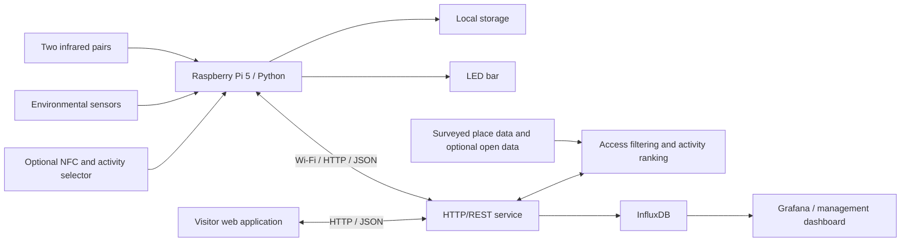

# NatureMatch
IoT station (Raspberry Pi 5) + API + activity assessment + Grafana. See `docs/`.

## Layout
- `src/naturematch/station`    sensors, IR counter, LED  (runs on the Pi)
- `src/naturematch/common`     shared data model (Observation, Quality, units)
- `src/naturematch/service`    HTTP/JSON API + InfluxDB persistence
- `src/naturematch/assessment` access filter + activity profiles (pure logic)
- `src/naturematch/web`        static web UI
- `deploy/`                    systemd units, Docker stack (InfluxDB, Grafana)

## Starting Sprint 1

Follow the [Sprint 1 task guide](docs/scrum/sprint-1.md) for the setup tasks, sensor tests and starting order. The existing scaffold and its commands need to be checked in [#47](https://github.com/aimarpg/NatureMatch/issues/47) before they are presented as verified installation instructions.

**Hardware update (15 November 2026):** the available counting hardware is two ultrasonic distance sensors, replacing the proposal's infrared pairs. The reported inventory also includes light, temperature/humidity, sound and an NFC reader. See the [wiring and pin inventory](docs/hardware/pin-inventory.md) for proposed socket reservations, required model/voltage checks and the revised counting test approach. Exact module revisions and Pi 5 driver compatibility remain unverified. The original PDFs and infrared scaffold have not been converted into an ultrasonic implementation; descriptions of infrared below refer to the original proposal. NFC remains optional for the MVP, and availability of the planned LED bar and activity selector is unconfirmed.

# Project description

**IoT for reconnecting with nature** · IoT Challenge 2026–27

NatureMatch is a proposed Internet of Things system to help people choose nearby green spaces that suit their intended activity, available time, preferences and access needs. Connected monitoring stations would measure visitor movements and environmental conditions, while a web application would turn those measurements into explained recommendations for studying, running, relaxing or meeting others outdoors.

**Project status: proposal and planning, with an initial repository scaffold.** The hardware, software and features described below are planned work, not validated capabilities. This README summarizes the [project proposal](Documents/IoTChallenge.pdf).

The repository now also contains a tested HTTP-ingest contract at
`POST /api/v1/observations`. It validates the shared `Observation` records,
handles retry duplicates by record ID and exposes per-station latest readings.
The current implementation uses in-process memory; durable InfluxDB writing,
station-to-API wiring and end-to-end hardware validation remain outstanding.

## Purpose and intended users

Knowing where a park is does not tell someone whether its current conditions suit their plans. NatureMatch aims to reduce that uncertainty so students, university staff and citizens can make nearby nature part of everyday life. The initial setting is campus gardens and green spaces in Bilbao, with a longer-term vision of supporting additional parks and institutions.

The proposed service has two audiences:

- **Visitors:** a browser-based application to find suitable places, understand the reasons for a recommendation and then put the screen away.
- **University and park managers:** a separate dashboard to inspect aggregate visitor estimates, environmental measurements and historical trends.

For example, a student with a break between classes could look for a quiet place to study within a short journey, requiring step-free access and tables. NatureMatch would first check recorded access and facility information, then rank suitable places using available measurements. It would explain the result, show when readings were taken and clarify that the presence of tables does not guarantee a free table.

## What the system would do

### Estimate occupancy

Two infrared transmitter/receiver pairs at an entrance would detect the order in which their beams are interrupted. Software on a Raspberry Pi would use those sequences to estimate entries and exits and maintain an occupancy estimate from a known initial count.

This estimate must be validated against manual observations. Occupancy for an entire area requires coverage of every entrance; the initial field test is limited to one entrance in a controlled setting. Missed crossings or interruptions in sensing would require reconciliation of the count.

### Measure local conditions

Grove sensors would collect temperature, humidity, sound level, light, UV and air-quality-related readings. Records would include timestamps, units and quality information so the interface can distinguish current, stale and unavailable data. Occupancy and noise would remain separate measurements.

The exact modules and their calibration will determine which claims are possible. The proposed Grove gas sensor provides a qualitative response, not pollutant concentrations or an official Air Quality Index. The UV sensor provides an approximate indicator, not an official UV Index. Noise readings need calibration before being presented as reliable decibel values.

### Recommend places by activity and access needs

The recommendation process would first check essential requirements, such as step-free access, path surfaces and rest facilities, against surveyed place information. It would then rank compatible places with activity-specific preferences: quiet studying, for example, would place different weight on noise and busyness than socializing.

Recommendations would explain their reasons and data limitations. Unknown access characteristics would need to remain explicit rather than being presented as verified suitability. Public weather, environmental and place data could complement station readings, with Euskalmet, Open Data Euskadi and Bilbao Open Data identified in the proposal as potential sources.

### Support optional activity check-ins

If time permits, an NFC reader and activity selector would allow visitors to register their intended activity voluntarily. Temporary sessions would end through check-out or expiry.

**Estimated visitors and active voluntary check-ins are different quantities.** Check-ins would never be added to the infrared occupancy estimate. An anonymous infrared exit cannot identify which activity session to close, and participation does not represent everyone at the location.

## Initial scope

The course minimum viable product (MVP) would demonstrate a complete sensing, analysis and feedback cycle using one Raspberry Pi station and a controlled entrance test.

| Area | Planned course scope |
| --- | --- |
| Station | Raspberry Pi 5, suitable Grove interfaces, two infrared pairs and environmental sensors |
| Local processing | Python crossing logic, occupancy estimates, timestamped measurements and local storage |
| Communication | Wi-Fi and an HTTP/REST interface exchanging JSON; periodic browser updates |
| Storage and monitoring | InfluxDB and a local Grafana dashboard for live and historical station data |
| Visitor application | Activity, time, distance and access inputs; explained recommendations with visible data freshness |
| Local feedback | LED bar providing feedback without requiring a phone |
| Optional addition | NFC reader, compatible test cards/tags, activity selector and temporary check-in sessions |
| Validation | Manual counting comparisons, sensor checks and a short, supervised, sheltered field test |

The initial prototype would use mains power and a suitable USB-C supply. Hardware interfaces, voltages, connectivity, sensor placement and actual energy use must be checked during implementation.

### Beyond the initial MVP

The following belong to the wider vision or need separate validation:

- A network of stations covering multiple parks and all entrances of monitored areas.
- MQTT communication between stations and a central service, with LoRaWAN for suitable remote nodes.
- ThingsBoard, Grafana Cloud or other managed infrastructure when scale justifies it.
- Battery or solar operation, subject to a measured energy budget and continuous counting requirements.
- Permanent outdoor installations with tested weather protection and secure mounting.
- Richer forecasting and additional interface accessibility features, such as screen-reader support and text alternatives to audio, identified as add-ons in the proposal.

Individual bench and table availability is outside the MVP. The prototype would also not provide certified environmental measurements or guaranteed occupancy accuracy.

## Proposed architecture



This is a logical design; the final service layout and web framework have not been selected. A local demonstration could operate without Internet access, while external data integrations or remotely hosted services would require connectivity. The station is intended to keep processing crossings and storing records during network interruptions while powered, then synchronize with timestamps and unique record identifiers to avoid duplicate processing.

## Privacy and responsible deployment

The proposal calls for anonymous infrared counting, sound-level measurements without recording or transmitting audio, and voluntary NFC sessions using temporary identifiers. No camera-based monitoring is planned. The visitor application is intended to work without an account; location filtering would take place on the user's device without storing location, and personal access requirements would not be exposed to other visitors.

HTTP is proposed for controlled tests on an isolated local network. Deployment beyond that environment would require HTTPS, authenticated administration and device credentials; future MQTT connections would use TLS. These are design requirements to implement and verify, not current security guarantees.

Environmental goals include modular, repairable hardware, measured power consumption, responsible end-of-life handling and placement that avoids disturbing wildlife. LED feedback would be dimmed and switched off at night.

## Planned development stages

The proposal originally outlined five stages. The later [initial project plan](Documents/Project%20Initial%20Plan.pdf) narrows that sequence to three dated sprints, which the GitHub backlog follows. These remain planned outcomes, not completed milestones.

| Sprint | Planned outcome |
| --- | --- |
| 1 · 3–17 November 2026 | Set up the project and board, test the selected sensors and LED, define shared records, compare entrance counts with manual observations and show local station status |
| 2 · 17 November–3 December 2026 | Connect station acquisition to HTTP/JSON, storage, Grafana and a simple interface for quiet studying and socialising with access checks |
| 3 · 3–11 December 2026 | Validate the integrated prototype, check reproducible setup and prepare documentation, the release and submission |

The dated plan selects infrared, temperature/humidity, noise and light for Sprint 1; UV, gas sensing and NFC remain optional. See the [Sprint 1 task guide](docs/scrum/sprint-1.md) for the issue list and module boundaries.

## Repository and getting started

### Standalone temperature/humidity test

The [base sensor test](src/naturematch/tools/hardware/read_temperature_humidity.py)
is implemented for **Grove DHT11/DHT22 only**, using the
[Seeed Python DHT driver](https://github.com/Seeed-Studio/Seeed_Python_DHT).
The physical sensor model, voltage/interface compatibility, wiring and Pi 5 driver
support must be confirmed before use. D16/BCM 16 in the
[pin inventory](docs/hardware/pin-inventory.md) is only a provisional reservation.
I2C sensors such as DHT20/SHT31 require a different driver; this script does not support them.

In a Raspberry Pi virtual environment with compatible `grove.py` and
`seeed-python-dht` installed, the following is an example **only after confirming
a DHT11 on BCM 16**:

```bash
python src/naturematch/tools/hardware/read_temperature_humidity.py --model 11 --pin 16
```

Use `--model 22` for a confirmed DHT22. The default is ten attempts, at least two
seconds apart; change these with `--samples` and `--interval`. Stop with Ctrl+C.
`--help` works without hardware dependencies. Each JSON line includes station ID
(`--station-id`, default `sensor-test`), UTC observation time, units and quality.
Readings are experimental and are not evidence of calibrated accuracy. Failed reads
produce null values with `missing`/`invalid` quality; they never reuse an old value.
Exit status is 0 if every attempt produced an in-range reading, 1 for initialization
or any reading failure, 2 for invalid arguments, and 130 for interruption during sampling.

The script intentionally uses the driver's private `_read()` single-attempt method:
its public `read()` can silently substitute cached readings or initial zeros after
failure. Check this interface when upgrading the driver. Output is diagnostic and
is not integrated with the station, storage or shared Observation model.

Software-only checks (mocked hardware) can run without third-party packages:

```bash
python -m unittest discover -s tests/unit -p test_temperature_humidity_tool.py
```

Physical sensor operation and Pi 5 compatibility have not been validated.

### Standalone noise sensor test

The [noise sensor test](src/naturematch/tools/hardware/read_noise.py) reads an
analog Grove sound module through the Grove Base Hat ADC. The exact module model
is unconfirmed. It reports experimental raw ADC counts (0–4095), **not calibrated
sound levels in dB**, and does not record or transmit audio.

Confirm the module model, voltage/interface compatibility, wiring and Pi 5 driver
support before use. A0 is a provisional socket reservation. In a Raspberry Pi
environment with compatible `grove.py` installed and Base Hat I2C configured,
after confirming A0, run:

```bash
python src/naturematch/tools/hardware/read_noise.py --channel 0
```

`--channel` selects a HAT ADC channel, not a BCM GPIO number. The ADC I2C address
defaults to `0x04`; override it with `--address 0x08` if that is the confirmed
address of the attached HAT. The address is included in each JSON record. The
default is ten attempts two seconds apart; `--samples`, `--interval` and
`--station-id` can change those values. `--help` works without hardware
dependencies. Each JSON line contains the station ID, UTC time, module/channel,
I2C address, raw value/unit and quality.
Failed reads produce `null` with `missing` or `invalid` quality; previous values
are never reused. Driver messages go to stderr to preserve JSON output. Exit
codes are 0 for all in-range reads, 1 for initialization or any read failure,
2 for argument errors and 130 for Ctrl+C during sampling. In-range readings
remain experimental; a numeric ADC result alone does not establish accuracy.

Software-only checks with mocked ADC hardware:

```bash
python -m unittest discover -s tests/unit -p test_noise_tool.py
```

Physical sensor operation and Pi 5 compatibility have not been validated.

### Standalone light sensor test

The [light sensor test](src/naturematch/tools/hardware/read_light.py) targets the
reported **Grove Light Sensor V1.2**, an analog module, through the Grove Base Hat.
It uses `grove.adc.ADC.read_raw()` from
[Seeed grove.py](https://github.com/Seeed-Studio/grove.py/blob/master/grove/adc.py)
and reports experimental 12-bit ADC counts (0–4095), **not lux**. It does not
support I2C light modules or integrate with station acquisition/storage.

Confirm voltage/interface compatibility, wiring and Pi 5 driver support before
use. A2 remains a provisional socket reservation. In a Raspberry Pi environment
with compatible `grove.py` installed and Base Hat I2C configured, after confirming
A2, run:

```bash
python src/naturematch/tools/hardware/read_light.py --channel 2
```

`--channel` selects a HAT ADC channel, not a BCM GPIO number. Like the temperature
script, this defaults to ten attempts two seconds apart and accepts `--samples`,
`--interval` and `--station-id`. The interval must be finite and positive.
`--help` needs no hardware dependencies. Each JSON line contains station ID, UTC
time, module/channel, raw value/unit and quality. Failed reads produce `null`
with `missing` or `invalid` quality; previous values are never reused. Driver
messages go to stderr to preserve JSON output. Exit codes are 0 for all in-range
reads, 1 for initialization or any read failure, 2 for argument errors and 130
for Ctrl+C during sampling. In-range readings remain experimental, and a numeric
ADC result alone does not prove that the sensor is connected or accurate.

Software-only checks with mocked ADC hardware:

```bash
python -m unittest discover -s tests/unit -p test_light_tool.py
```

Physical sensor operation and Pi 5 compatibility have not been validated.

The repository contains project documentation and an initial source, configuration and tooling scaffold, including test files and unfinished sensor adapters. This supersedes the earlier documentation-only description; those files do not establish a working or hardware-validated application. Setup, wiring, execution and test instructions must be checked and updated as the Sprint 1 tasks are completed.

- [Project proposal](Documents/IoTChallenge.pdf): system purpose, architecture, scope, risks and initial sprint plan.
- [Initial project plan](Documents/Project%20Initial%20Plan.pdf): dated three-sprint development plan.
- [Sprint 1 task guide](docs/scrum/sprint-1.md): clear issue names, module responsibilities and starting order.
- [Agent instructions](AGENTS.md): repository guidance for future coding agents.

## Team

Aimar Pagonabarraga · Alessandro Berti · Leire Larrauri
